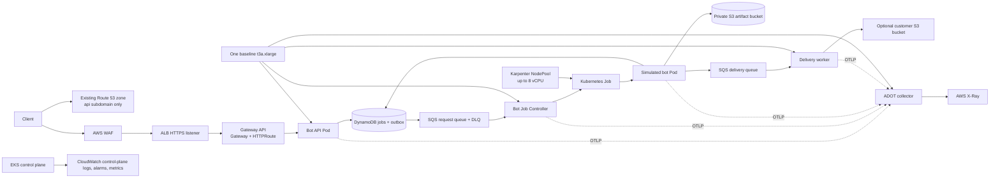

# EKS meeting-bot learning platform

This repository builds a small AWS EKS platform for a **simulated** meeting bot. It accepts an HTTPS request, records a durable job, queues work, starts one Kubernetes Job per request, writes a text artifact to S3, and reports state through the API. It does not join Google Meet, Teams, or Zoom. The URLs are validated only to shape a future provider adapter.

The repository is ready for review and local validation. **No AWS resources have been created.** Terraform and the scripts contain explicit apply/delete prompts; inspect the cost report and plan before you run them.

## What runs



The ALB terminates public TLS with ACM. It talks HTTPS to the API Pod using a short-lived self-signed backend certificate; the controller health-checks the same HTTPS endpoint. The ALB is internet-facing, while EKS nodes are private. The EKS API's public endpoint is restricted to `admin_cidrs` and has private access enabled.

The controller uses a transactional outbox in DynamoDB so an API success cannot be lost between a database write and SQS publication. SQS is at-least-once; controller retries reuse the deterministic Kubernetes Job name and tolerate already-created Jobs. Completed Jobs have a 180-second TTL. The baseline uses one `t3a.xlarge`; Karpenter uses on-demand `t3a.large` workers with an 8-vCPU ceiling (up to four nodes) and `WhenEmpty` consolidation so active sessions are not consolidated away. T3a nodes are burstable, so this is a low-cost learning choice rather than a steady-CPU production recommendation.

## Repository map

| Path | What it owns |
|---|---|
| `terraform/environments/learning` | VPC, EKS, IAM, DynamoDB, SQS, S3, ECR, ACM, WAF, alarms, monthly cost alert |
| `terraform/environments/cluster-addons` | Kubernetes namespaces/RBAC/service accounts, Karpenter, ALB controller, ExternalDNS, Argo CD, OTEL config |
| `terraform/charts/karpenter-config` | Terraform-managed Karpenter `NodePool` and `EC2NodeClass` |
| `kubernetes/chart` | GitOps-managed API, workers, Gateway API resources, and OTEL collector |
| `services` | Four Go binaries: API, controller, simulator, and delivery worker |
| `scripts` | Preflight, gated deploy, build/push, GitOps setup, smoke checks, inspection, teardown |
| `tests/integration/e2e.sh` | Live AWS/EKS integration checks; requires a deployed platform |
| `docs` | [Deployment guide](docs/deployment-guide.md), architecture, cost estimate, and troubleshooting |

Terraform owns the baseline node group and Karpenter configuration. Karpenter owns the EC2 instances it launches. Their count changing is expected and does not create Terraform drift because those instances are not declared as Terraform resources.

## Pinned component versions

Versions were checked on 22 October 2026. Recheck regional EKS add-on availability before applying.

| Component | Version |
|---|---:|
| EKS / Kubernetes | 1.36 |
| AWS VPC CNI | `v1.22.4-eksbuild.3` |
| CoreDNS | `v1.14.7-eksbuild.10` |
| kube-proxy | `v1.36.0-eksbuild.21` |
| Karpenter | `1.15.0` |
| AWS Load Balancer Controller Helm chart/controller | `3.6.0` |
| Gateway API standard CRDs | `v1.6.0` |
| ExternalDNS Helm chart | `1.19.0` |
| Argo CD Helm chart | `8.5.0` |
| ADOT collector image | `v0.50.0` |
| Terraform AWS provider | `5.98.0` |
| Terraform Kubernetes provider | `2.36.0` |
| Terraform Helm provider | `2.17.0` |

The AWS Load Balancer Controller has GA Gateway API support in the v3 line. This configuration uses its ALB Gateway controller with the standard Gateway API and AWS-vended configuration CRDs. See the [Gateway API guide](https://github.com/kubernetes-sigs/aws-load-balancer-controller/blob/main/docs/guide/gateway/gateway.md) and [AWS Gateway API GA announcement](https://aws.amazon.com/blogs/networking-and-content-delivery/aws-load-balancer-controller-adds-general-availability-support-for-kubernetes-gateway-api/). The deployment script applies the version-pinned CRDs after you approve add-on installation.

## Account-specific inputs

You need an AWS CLI profile or another standard AWS SDK credential source, an existing **public** Route 53 zone, your domain name, and the public IPv4 CIDR(s) allowed to administer the EKS API. Do not paste access keys into this repository.

```bash
cd terraform/environments/learning
cp terraform.tfvars.example terraform.tfvars
```

Edit `terraform.tfvars`:

- Replace the hosted-zone ID and domain.
- Replace `203.0.113.10/32` with your current trusted public IPv4 `/32`.
- Choose an unused API subdomain. The preflight script refuses a hostname that already has records.
- Optionally set `budget_alert_email` and `github_repository`.
- Leave all three delivery inputs empty unless you have configured the destination account role and bucket policy.

`terraform.tfvars`, Terraform state, generated API tokens, and TLS keys are ignored by Git.

## Preflight and cost review

The preflight is read-only. It checks the current AWS principal, account, public hosted zone, unused API host, three available AZs with `t3a.xlarge` and `t3a.large` offerings, EKS version support, and EC2 vCPU quota.

```bash
scripts/preflight.sh Z0123456789EXAMPLE example.com api.example.com ap-south-1
```

Read [docs/cost-estimate.md](docs/cost-estimate.md) before provisioning. The `monthly_budget_usd` default creates a project-tag-filtered monthly budget, and optionally emails at 80% and 100%. A budget is an alert; it does not stop AWS from charging. The Karpenter 8-vCPU limit caps elastic bot compute, but does not cap EKS, NAT, ALB, WAF, data transfer, or baseline-node costs.

## Create infrastructure (not run by this build)

`scripts/deploy.sh` runs the read-only identity, hosted-zone, hostname, AZ, instance-offering, EKS-support, and quota preflight from `terraform.tfvars`, formats and validates Terraform, creates a plan, and stops without applying. `scripts/deploy.sh --apply` displays the plan and requires the exact typed phrase `APPLY <cluster>` before the infrastructure apply. It then creates a second add-on plan and requires `APPLY ADDONS <cluster>` before installing the pinned Gateway CRDs and cluster add-ons.

```bash
scripts/deploy.sh
# Review the plan file in terraform/environments/learning.
scripts/deploy.sh --apply
```

The script never creates the Route 53 hosted zone. ACM DNS validation adds only its validation CNAME record. ExternalDNS is scoped to the supplied zone and API hostname, uses a unique TXT owner, and synchronizes only its owned records.

Terraform is configured for encrypted, versioned S3 state with native locking. Migrate the existing local state files before running further plans or applies; see [docs/cicd.md](docs/cicd.md#one-time-state-migration).

## Publish and deploy the application

After both approved Terraform stages complete:

```bash
aws eks update-kubeconfig --region ap-south-1 --name meeting-bot-learning
scripts/create-api-secrets.sh
scripts/build-push.sh bootstrap-$(date +%Y%m%d%H%M%S)
scripts/connect-gitops.sh https://github.com/OWNER/REPOSITORY.git
```

The build script creates four immutable ECR image tags, then writes Terraform output identifiers and the image references to `kubernetes/chart/values-learning.yaml`. Review and commit that file. For a private GitHub repository, register it with Argo CD using your approved Git credentials before applying the Application. The API token is saved in `.local/api-token`; treat it as a password.

The `.github/workflows/ci-publish.yml` runs application checks on pull requests. On `main`, it uses GitHub OIDC to build and scan immutable images, push them to ECR, and open a pull request updating the GitOps image tags. Merge that reviewed PR to `main` for Argo CD to deploy it.

Terraform plan and approval-gated apply automation uses GitHub-hosted runners in `.github/workflows/terraform-plan-apply.yml`. Follow [docs/cicd.md](docs/cicd.md) to migrate the local state and configure the GitHub environments and OIDC roles before enabling it. Cluster add-ons stay manual because the EKS API is restricted to approved network ranges.

## Verify the full workflow

```bash
tests/integration/e2e.sh
```

It verifies the dedicated DNS alias, valid HTTPS, WAF association, healthy ALB target, API validation, idempotent create, DynamoDB record, Kubernetes Job, completion status, S3 artifact download, and cancellation. Set `WAIT_FOR_TTL_CLEANUP=1` to also wait for the 180-second Job TTL. This test creates demo jobs and S3 artifacts.

For a smaller load experiment, use `scripts/submit-bots.sh 4 120`, then `scripts/inspect.sh`. Each `t3a.large` worker has resource requests for about two simulator Pods; actual allocatable CPU and memory, system Pods, and placement determine whether both fit. No strict per-node Pod count is configured. T3a uses CPU credits: if sustained utilization exceeds its baseline, Unlimited mode can add CPU-credit charges. Check the credit balance if a long demo appears CPU-throttled or unexpectedly expensive.

## Teardown

```bash
scripts/teardown.sh
```

The script refuses to destroy while active Jobs, Karpenter NodeClaims, the Argo Application, the Gateway or its tagged ALB, or records at the API hostname remain. Once those checks pass, it requires `DELETE <cluster>` and destroys only the two project Terraform stacks. It intentionally preserves the hosted zone and unrelated records. Terraform empties the project artifact bucket; download anything you want to keep first. Review [docs/troubleshooting.md](docs/troubleshooting.md) before removing state or assuming every billable resource is gone.

## Service API

```http
POST /bots
Authorization: Bearer <token>
Idempotency-Key: <unique-key>
Content-Type: application/json

{"meetingUrl":"https://meet.google.com/demo-room","durationSeconds":30}
```

`GET /bots/{job_id}` returns status and artifact key; `GET /bots/{job_id}/artifact` redirects authenticated callers to a 15-minute S3 download URL after completion; `POST /bots/{job_id}/cancel` requests cancellation. Supported URL hosts are `meet.google.com`, `teams.microsoft.com`, `zoom.us`, and `zoom.com`. Only `https` URLs are accepted. The initial auth model is one shared bearer token for a single learning environment; it is not per-customer identity or multi-tenant authorization.

Job states: `REQUESTED → STARTING → JOINING → RECORDING → UPLOADING → COMPLETED`, with `FAILED`, `CANCEL_REQUESTED`, and `CANCELLED` terminal/error paths. Delivery is tracked separately as `SKIPPED`, `FAILED`, or `DELIVERED`.

## Limitations

- The meeting-bot generates a text file; no browser automation or provider API is included.
- The API uses one shared token and is a single-tenant demo.
- OpenTelemetry traces go to AWS X-Ray. EKS control-plane logs, SQS/DLQ alarms, and AWS service metrics go to CloudWatch. Application JSON logs are available with `kubectl logs`; a CloudWatch Container Insights/Fluent Bit pipeline is not enabled.
- CloudWatch metrics do not yet include custom cost-per-meeting or bot startup histograms. The job ID is carried through state, queue events, Kubernetes labels, logs, and trace attributes.
- One NAT Gateway is a deliberate cost/availability tradeoff; the private subnets in other AZs egress through it.
- Terraform local state and the shared bearer token are learning defaults, not production credential/state patterns.
