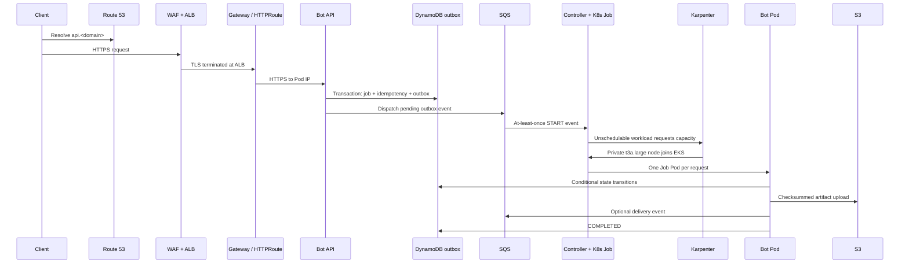

# Architecture and resource inventory

## Request path and ownership

The DynamoDB transaction keeps the job, idempotency record, and outbox event atomic. The dispatcher can send a duplicate if it crashes after SQS accepts a message but before the outbox row changes to `SENT`. The controller handles that duplicate by retrying the deterministic `meeting-<job-id>` name. A Kubernetes `409 AlreadyExists` is treated as successful handoff. The controller acknowledges SQS only after the request has been safely handed to a Job or found terminal.

SQS redrive moves messages after five failed receives to a 14-day DLQ. The controller does not automatically replay DLQ messages: inspect the cause, fix it, then redrive them using the SQS console or the AWS CLI. Do not delete a DLQ message before the associated job state has been checked.

The meeting Pod writes its state with conditional DynamoDB transitions. A restart does not resume an in-progress browser session; there is no browser session in this simulator. A real provider adapter must persist resumable session/checkpoint information or mark an interrupted meeting failed and require an explicit retry policy.

## AWS and Kubernetes inventory

| Layer | Resources | Owner |
|---|---|---|
| Network | VPC, three public and three private subnets, route tables, IGW, one NAT Gateway/EIP, S3 and DynamoDB gateway endpoints | Terraform networking module |
| Cluster | EKS 1.36 control plane, private and restricted public API endpoint, cluster logs, one managed `t3a.xlarge` baseline node | Terraform EKS module |
| Elastic workers | One `NodePool`, one `EC2NodeClass`, IAM node role; max 8 vCPU, on-demand `t3a.large` nodes in tagged private subnets | Terraform installs config; Karpenter owns launched instances |
| Edge | One DNS-validated ACM cert, regional WAF Web ACL, ALB provisioned by Gateway API, existing Route 53 zone | Terraform creates cert/WAF; AWS LBC creates ALB; ExternalDNS creates only API records |
| Data | PAY_PER_REQUEST DynamoDB table/GSI/TTL, encrypted SQS queues/DLQs, private encrypted S3 bucket, four immutable ECR repos | Terraform data module |
| Identity | Per-service IRSA roles for API, controller, bot, delivery, collector, LBC, ExternalDNS; optional GitHub OIDC publisher | Terraform EKS module |
| Add-ons | AWS VPC CNI, CoreDNS, kube-proxy, Karpenter, AWS LBC, ExternalDNS, Argo CD, ADOT collector | Terraform |
| Applications | API, controller, delivery worker, one-off simulator Jobs, Gateway/HTTPRoute, X-Ray collector Deployment | Helm chart through Argo CD |
| Spend visibility | CloudWatch EKS control-plane logs (7 days), SQS/DLQ alarms, monthly project-tag budget | Terraform |

S3 and DynamoDB gateway VPC endpoints avoid NAT processing charges for those destinations. ECR image pulls, package fetches, OTLP-to-X-Ray, and other public endpoints can use the single NAT and incur transfer/processing charges.

## Gateway API and ALB

The AWS Load Balancer Controller 3.6.0 supports the Gateway API's `Gateway`, `HTTPRoute`, and AWS-vended `LoadBalancerConfiguration`/`TargetGroupConfiguration` resources. The deployment process installs Gateway API v1.6.0 standard CRDs and the matching v3.6.0 AWS CRDs before the Helm release starts. The chart defines an HTTPS-only listener, an ACM certificate, WAFv2 association, HTTPS Pod IP targets, and `/healthz` health checks. The ALB controller owns the resulting ALB; do not edit the ALB directly in the AWS console because reconciliation can revert manual changes.

ExternalDNS reads only `gateway-httproute` objects in `meeting-bot`, filtered to the single configured hostname and hosted-zone ID. Its TXT registry owner is the EKS cluster name. `--policy=sync` removes only records with that owner when the route disappears.

## Terraform state

Both Terraform roots are configured to use the dedicated S3 bucket `meeting-bot-tfstate-481665121849-ap-south-1` in `ap-south-1`. It has public access blocked, bucket-owner-enforced ownership, default SSE-S3 encryption, versioning enabled, and a TLS-only bucket policy. The roots use separate state keys and native S3 lockfiles:

- `meeting-bot-platform/learning/terraform.tfstate`
- `meeting-bot-platform/cluster-addons/terraform.tfstate`

The add-ons root reads the learning root's state from the first key. State can contain sensitive values; never commit state files or saved plan files. Run `terraform init -migrate-state` in each root once to move the existing local states to S3. Keep the bucket outside the cluster Terraform roots so teardown cannot delete the state needed to clean up the cluster.

## Customer-owned S3 delivery

Set `delivery_bucket`, `delivery_destination_role_arn`, and `delivery_destination_account_id` together. The workload IRSA role may assume only the configured role ARN. In the customer account, that role must trust the exact source `delivery` IRSA role and allow `s3:PutObject` only to the destination prefix. The worker uses `ExpectedBucketOwner` and `ExpectedSourceBucketOwner` headers, assumes a short-lived role, and copies to `meeting-bot/<job-id>/artifact.txt`; it stores no long-term customer keys. The source artifact IAM role can only read `artifacts/*` from this project's bucket.
